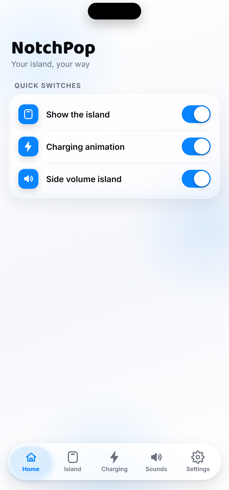
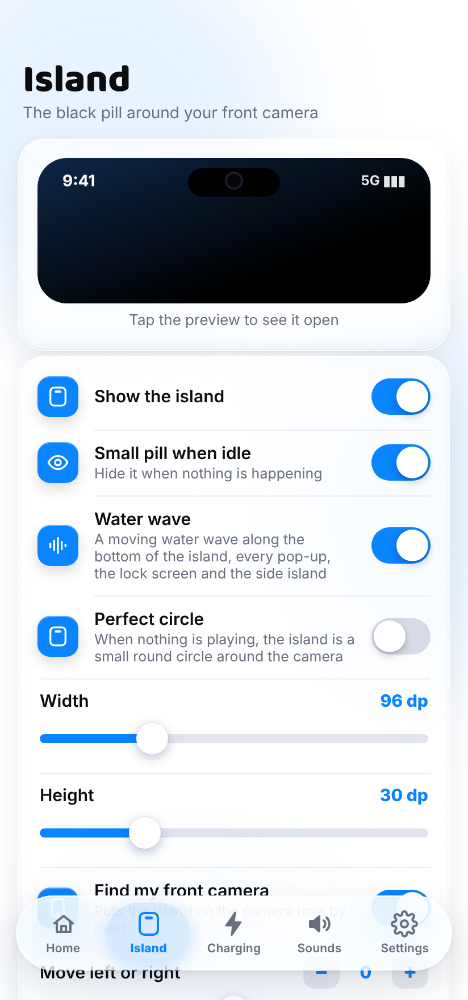
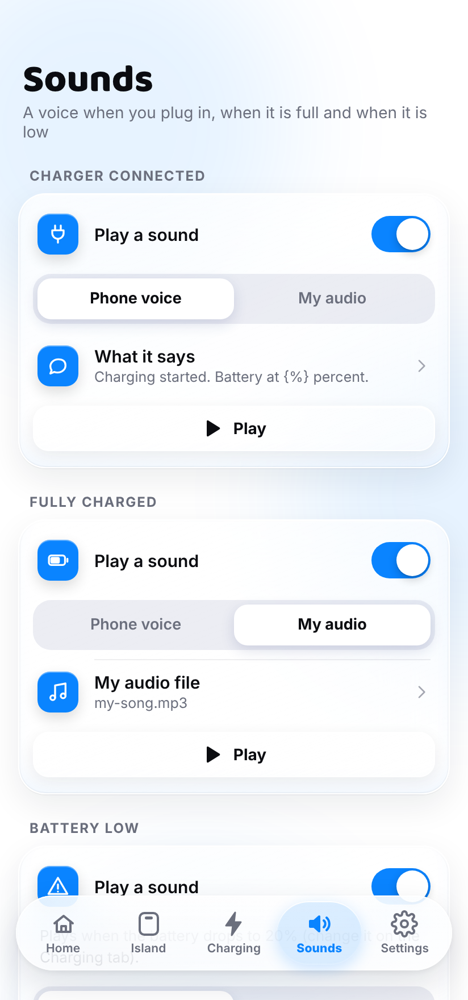

<h1 align="center">NotchPop</h1>

<b>A Dynamic-Island-style pop-up for any Android phone.</b> Free, no ads, no account.

<a href="https://github.com/Delvinghoghari/notch-app/releases/latest/download/NotchPop.apk"><b>⬇ Download NotchPop.apk</b></a>

## What it does

- **Island around the camera:** music, calls, timers, alarms, charging and earbuds pop out of a black pill around your front camera.
- **Charging animation:** a full-screen animation and an optional voice when you plug in, when the battery is full or when it is low.
- **Side island:** swipe from the left edge for Volume, Silent / Vibrate / Ring, Screenshot and Search, all in one smooth scroll.
- **Day and night look:** follows your phone, or pick one.
- **Updates itself:** NotchPop tells you when a new version is out, and the Update button turns blue.

## Screenshots

## Install

1. Tap **Download NotchPop.apk** above on your phone.
2. Open the downloaded file. If Android asks, allow **Install unknown apps** for your browser.
3. Tap **Install**, then open NotchPop.
4. The first time, a **Set up NotchPop** list shows every permission in order. Only **Display over other apps** is needed; the rest turn on extra features.

Works on Android 5 and newer (Samsung, OnePlus, Xiaomi, Realme, Vivo, Oppo, Pixel and more).
On some phones, set NotchPop's battery to **Unrestricted** so the phone never stops it.

## Privacy

NotchPop collects no data. It has no account, no ads and no analytics.
It uses the internet only to check this page for a new version.
Song names and call info are read only to show them in the island and are never saved or sent anywhere.

---
Made by Simple Studios.
